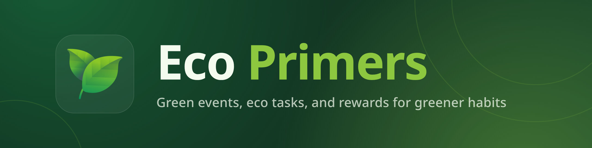

<div align="center">
  
  <p><a href="https://ecoprimers.dennise.me">Website</a> • <a href="LICENSE">License</a></p>
</div>

---

Eco Primers is a gamified sustainability community that rewards people for eco-friendly habits. Members join green events, complete tasks verified by AI from a photo, earn points to redeem for rewards, and share their progress with each other.

It is a server-rendered Flask app with small TypeScript client scripts, deployed as a Cloudflare Python Worker backed by Neon Postgres and S3-compatible storage.

## Features

- **Events**: Browse green events, sign up, and withdraw.
- **Tasks**: Submit a photo for a task and earn points when an AI model approves it.
- **Rewards**: Redeem points for reward products and export point transactions to Excel.
- **Community**: Post, comment, like, save, and follow other members.
- **Messaging**: Send direct messages with real-time delivery over WebSockets.
- **Chatbot**: Ask an AI assistant for sustainability tips.
- **Administration**: Manage users, events, tasks, products, and transactions with engagement analytics.

## Tech Stack

- [Flask](https://flask.palletsprojects.com) for routing and server-rendered Jinja templates.
- [Bootstrap](https://getbootstrap.com) for layout, components, and theming.
- [SQLAlchemy](https://www.sqlalchemy.org) and [Alembic](https://alembic.sqlalchemy.org) for the data models and migrations.
- [Neon](https://neon.com) for hosted Postgres, reached through Cloudflare Hyperdrive.
- [Cloudflare Workers](https://developers.cloudflare.com/workers) for hosting, with a Durable Object for real-time messaging.
- [OpenRouter](https://openrouter.ai) for task verification, the chatbot, and admin recommendations.
- [Bun](https://bun.sh) for bundling, linting, formatting, and type-checking the TypeScript client.
- [uv](https://docs.astral.sh/uv), [Ruff](https://docs.astral.sh/ruff), and [ty](https://docs.astral.sh/ty) for Python dependencies, linting, formatting, and type checking.

## Getting Started

### Prerequisites

- [Bun](https://bun.sh) 1.4 or newer
- [uv](https://docs.astral.sh/uv) with Python 3.12 or newer
- [Just](https://just.systems)
- [Docker](https://www.docker.com) with Docker Compose

### Setup

1. Copy `.env.template` to `.env` and fill in the keys.

   ```sh
   cp .env.template .env
   ```

2. Install dependencies, start the local Postgres and S3 services, and migrate the database.

   ```sh
   just setup
   ```

3. Start the development server and open http://localhost:3000.

   ```sh
   just start
   ```

## Documentation

- [Cloudflare Development](docs/guides/cloudflare.md)

## License

Licensed under the [MIT License](LICENSE).
